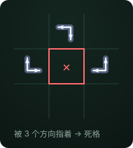
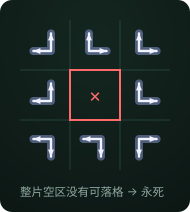
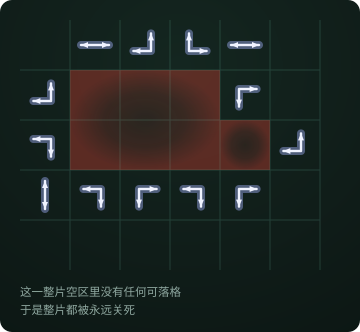

# Double Arrow

This is a game I designed. The rules are simple — my little sister, who is in third grade, picked them up in about a minute — but I think it may have a very high ceiling.

I have been training an AI on it. After more than half a month of work, the current version still cannot reliably beat a player that moves completely at random. Below are the rules, what I have observed, what I tried and failed at, and a few questions I cannot answer. If anyone can spot where I went wrong, or suggest a different training approach, I would be very grateful.

## Contents

| File | What it is |
|---|---|
| [RULES.md](RULES.md) / [RULES.en.md](RULES.en.md) | Rules (Chinese / English) |
| [engine.py](engine.py) | Dependency-free rule engine, written out cell by cell |
| [Play online](https://tttuuunnn.github.io/DoubleArrow/play/arrow-chess.html) | Playable in a browser; includes a UCT sparring partner. Or download `play/arrow-chess.html` and open it locally |
| [assets/](assets/) | Rule diagrams (SVG) |

## Quick start

**Just want to play?** Open [Play online](https://tttuuunnn.github.io/DoubleArrow/play/arrow-chess.html) — nothing to install. Or download `play/arrow-chess.html` and open it locally.

**Want to check the rules?** Run `python engine.py`. It prints the number of legal moves at the start (24) and a count of each cell class. Your own implementation should produce the same numbers; if it does not, we disagree about the rules.

**Want to build an AI?** `engine.py` exposes four functions — `initial_board`, `legal_moves`, `play`, `analyze` — enough for random play, minimax or UCT.

## What I observed

### Dead cells

The opening has only 4 pieces and 140 empty cells, so the game looks like it is decided purely by turn order. But the two placement rules almost inevitably produce cells that can never be played again — I call them **dead cells**. Every position I have seen has some.

There are two causes.

**Cause 1: pointed at from three or more directions.**
A cell like this has no legal piece types left, so it can never be played.

**Cause 2: the whole empty region it belongs to contains no playable cell.**

First, an **empty region**: treat placed pieces, plus the dead cells from Cause 1, as walls. The remaining empty cells then split into connected regions, and each one is an empty region.

If a region contains no playable cell at all, the whole region is sealed off forever. (This is rare in practice.)

**Consequences.** Dead cells are irreversible, and they can make whole regions collapse: one cell dying can cut a region off from every playable cell and kill all of it. And since at the end of the game every empty cell is dead, **dead cells = 140 − total moves**, so the two always have the same parity.

That means the result is tied directly to the parity of dead cells at the end: odd → the first player wins, even → the second player wins.

Whether dead-cell parity tells you anything *during* the game, I do not know (see Q4 below).

But that is exactly what the game is about: finish with a dead-cell parity that favours you — in other words, be the player who places the last piece.

### Legal moves: few in one game, almost no overlap across games

At move 70 there are on average only 25 legal cells and about 55 legal moves, far fewer than Go (roughly 250). Yet **two games at the same move number share almost no legal cells** — only about 12% overlap. Meanwhile, if you pool 120 games, 139 of the 144 cells have been legal at some point.

So "few legal moves" is a single-game view. Across many games, the legal cells at a given move number spread over almost the whole board.

### Other observations

- The number of legal piece types for a cell depends only on how many directions point at it:

| directions pointing at it | 0 | 1 | 2 | ≥3 |
|---|---|---|---|---|
| legal piece types | 0 | 3 | 1 | 0 |

- Game length: under several obviously silly strategies it lands around 111 (seal as fast as possible), 122 (random), 129.5 (greedy survival, keeping as many cells alive as possible) and 138 (both sides using one uniform orientation); with my current weak model it is about 123. These numbers are only indicative — the games come from a very weak player and may not reflect the game's real shape.

**My guess:** the difficulty is not the branching factor, but extremely delayed and sparse reward — a single bit at the very last move.

## What I tried and failed at

- **Value head.** It fits the training set to 75% accuracy, but on unseen positions only 51% — basically guessing.
- **More simulations.** No help: at 800 simulations the visit distribution is indistinguishable from a random allocation.
- **"The endgame should be solvable."** It is not. I took positions with 6 moves left and solved them exactly; the fraction of visits landing on winning moves matched the fraction of winning moves almost exactly — again, no better than guessing.
- **"The top-*k* priors should contain the answer."** They do not. Across 45 winning endgame positions, the prior's top-1 was a winning move 17.8% of the time, while random selection would hit 24.2%.
- **"Piecewise backfill, 20 moves per segment."** The premise fails. Full expansion multiplies cost at every layer: with 6 moves left and about 14 candidates each, that is roughly 2.2 million nodes, so 800 simulations cover 0.04%.
- **"Use exact endgame solving as training data."** Not enough coverage. There are at least ~10^6 distinct endgame positions; solving 100k covers 1–10%.

## Questions I cannot answer

**Q1 — Can it be decomposed with combinatorial game theory?**

I think there is a strict structural property: **a move only affects the empty region it belongs to, and regions do not interact.**

The reasoning: a piece's two arrows point at two adjacent cells. If that adjacent cell is empty, it is necessarily in the same region; if it is a piece, it does not affect legality. And since pieces are never removed, the way a region can be entered from outside is fixed for good.

If that holds, the mid- and endgame decompose into a disjoint sum, and Sprague–Grundy machinery applies.

But I can see several holes:

- Regions only appear in the mid- and endgame. Early on the board is a single region, so there is nothing to decompose.
- Where and when regions appear depends on how both players play; it is not fixed.
- Even if a region can be solved, the early "single region" problem remains.

So it could only help in the mid- and endgame, and even that premise is shaky.

**Q2 — Is there a known strong strategy at the level of the rules?**

The outcome depends only on the parity of the total number of moves, and that total can be pushed across a range of about 30. Is "how to steer the final move count to the parity you need" a problem with a known theoretical answer?

**Q3 — Is 800-simulation search equal to random because of the input, or because the game is genuinely unpredictable?**

If the input is missing something important, it can be fixed. If it is fundamental — a static position really cannot predict a parity 100 moves ahead — then more compute will not help, and the target has to change.

**Q4 — Can in-game dead-cell parity be treated as an "advantage"? And where is the strategic depth?**

The only quantity that even looks like an advantage is the parity of dead cells. It is a bit like the sign of the score difference in Go — except Go also has a magnitude, while here only a sign remains.

And that sign is unstable: a good enough strategy might deliberately concede an unfavourable parity in exchange for a position that becomes unstoppable later; and because the board wraps, opening moves may pay off very late. However the parity oscillates, only the last flip decides it. So it seems one can only look at the global shape of the position, never at a local part.

So I suspect this game is hard to train — which is also why I think it may have a very high ceiling. Most likely I am simply not good enough and wrong about something. I did follow a lot of Go training methodology (the AlphaZero family) and it did not get far. If anyone here has an idea, I would love to hear how you would approach it.

## License

Rules and text: CC BY 4.0. Code: MIT.
