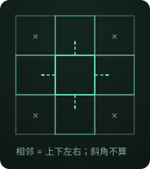
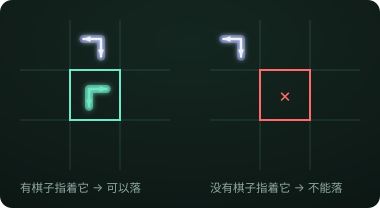
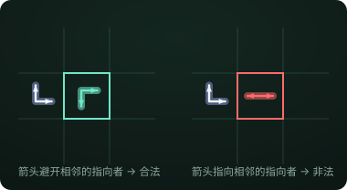

# Double Arrow · Rules

## 1 · Pieces

There are six piece types (any two of the four directions: up, right, down, left).

## 2 · Board

A 12×12 torus: the top and bottom edges are joined, and the left and right edges are joined. A game starts with four pieces in the central 2×2, each pointing diagonally outwards, so 140 empty cells remain.

## 3 · Rules

### Adjacency

"Adjacent" means up, down, left or right, not diagonal. Because the board is a torus, row 12 is adjacent to row 1, and column 12 is adjacent to column 1.

### Placement

① The target cell must be pointed at by an adjacent piece.

② A new piece's two arrows must not point at any adjacent piece that already points at this cell.

### End of the game

Whoever has no legal move on their turn loses. Pieces have no colour or side.
